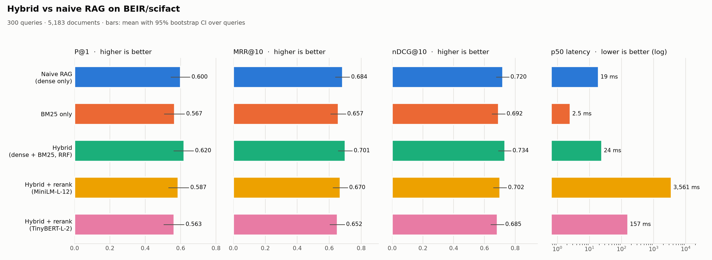
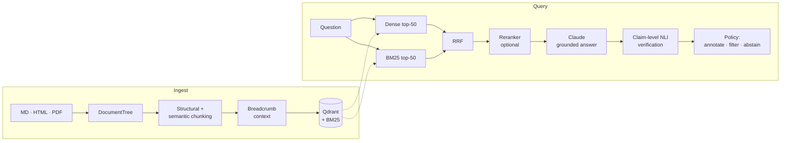

# Production-Grade Hybrid RAG

[](https://github.com/pedrohbenetton/production-grade-hybrid-RAG/actions/workflows/ci.yml)
[](LICENSE)
[](https://www.python.org/downloads/)
[](https://github.com/astral-sh/ruff)
[](https://mypy-lang.org/)

Retrieval-augmented generation that is measured instead of assumed: dense + BM25 retrieval fused
with Reciprocal Rank Fusion, optional cross-encoder reranking, and **claim-level faithfulness
guardrails** that check every sentence of an answer against the passages it cites.

Python 3.12+ · strict type hints · Pydantic v2 · FastAPI/OpenAPI · Qdrant · 241 tests, 93% coverage ·
`mypy --strict` and `ruff` clean.

## Does hybrid beat naive RAG? Measured on BEIR/SciFact



300 test queries over 5,183 abstracts, every document ingested through the same pipeline the API
uses. Bars show the mean with a 95% bootstrap CI over queries.

| System | P@1 | MRR@10 | nDCG@10 [95% CI] | p50 latency |
|---|---:|---:|---:|---:|
| Naive RAG (dense only) | 0.600 | 0.684 | 0.720 [0.676, 0.761] | 19 ms |
| BM25 only | 0.567 | 0.657 | 0.692 [0.648, 0.736] | 2.5 ms |
| **Hybrid (dense + BM25, RRF)** | **0.620** | **0.701** | **0.734** [0.690, 0.775] | 24 ms |
| Hybrid + rerank (MiniLM-L-12) | 0.587 | 0.670 | 0.702 [0.657, 0.745] | 3,561 ms |
| Hybrid + rerank (TinyBERT-L-2) | 0.563 | 0.652 | 0.685 [0.640, 0.727] | 157 ms |

**What the data supports, and what it does not**

- Hybrid ranks first on every ranking metric, at the cost of ~5 ms over dense-only search.
- **The gap over naive RAG is within noise on this dataset:** ΔnDCG@10 = +0.015, paired bootstrap
  95% CI [−0.012, +0.039]. The direction matches the theory; 300 queries cannot prove it.
- **Cross-encoder reranking did not help here.** TinyBERT was significantly worse than plain hybrid
  and MiniLM neutral-to-worse, at 6–150× the latency. Generic MS MARCO rerankers are a plausible
  mismatch for scientific claims (a hypothesis I did not test). Reranking is a per-domain decision
  this repo lets you validate rather than assume.
- **Sanity check:** the harness reproduces published BEIR numbers (BM25 0.692 vs ≈0.665; bge-small
  0.720 vs ≈0.71), so the comparison is not silently broken.
- One dataset is one data point. Full tables, paired differences and notes:
  [docs/benchmark.md](docs/benchmark.md). Reproduce with `uv run --group bench hybrid-rag-bench`.

## How it works



- **Ingestion** normalizes Markdown, HTML and PDF into one `DocumentTree` (PDF headings are
  recovered from font-size statistics; running headers and footers are removed), then chunks in two
  passes: by structure, then by embedding-based semantic splitting only where a section exceeds the
  token budget. Code blocks and tables are never split.
- **Chunk IDs are content-addressed.** Re-ingesting an unchanged document embeds nothing; an edited
  section replaces only its own chunk.
- **Retrieval** fuses dense and BM25 rankings with RRF (`Σ w/(60 + rank)`), which needs no score
  calibration between cosine similarity and BM25. BM25 is a small incremental implementation whose
  `remove()` is tested to be equivalent to never having indexed the chunk.
- **Guardrails** split the draft into claims, check each against the passages it cites with a local
  NLI cross-encoder (int8 ONNX, no torch), and apply a policy. Citation accuracy is strict: a claim
  that cites the wrong passage is not rescued by another one.
- Every stage is a `Protocol`; the only place that picks concrete adapters is
  [`api/container.py`](src/hybrid_rag/api/container.py).

Deeper write-up, including measured trade-offs: [docs/ARCHITECTURE.md](docs/ARCHITECTURE.md).

## Quickstart

```bash
uv sync
cp .env.example .env          # optional: set ANTHROPIC_API_KEY to enable /v1/query
uv run uvicorn --factory hybrid_rag.api.app:create_app
```

Swagger UI at <http://localhost:8000/docs>. Models (~130 MB embedder, ~180 MB NLI when generation
is enabled) download on first use into `./data/models`.

**Index documents**

You can index documents directly through the API while the server runs:

```bash
# Ingest Markdown or HTML from JSON payload
curl -s localhost:8000/v1/ingest -H 'content-type: application/json' \
  -d '{"source_uri": "notes.md", "content": "# Architecture\n\nHybrid RAG combines dense and BM25 retrieval."}'

# Or upload a file (.md, .html, .pdf)
curl -s localhost:8000/v1/ingest/file -F "file=@sample.md"

# Delete a document by doc_id (or source_uri)
curl -s -X DELETE localhost:8000/v1/documents/notes.md
```

You can also index programmatically in Python (embedded Qdrant is single-process, so do this with
the server stopped or point both at a Qdrant server with `RAG_QDRANT__URL`):

```python
from pathlib import Path
from hybrid_rag.api.container import build_container
from hybrid_rag.config import Settings
from hybrid_rag.ingestion.sources import load_file

c = build_container(Settings())
for path in Path("docs").glob("*.md"):
    print(path.name, c.indexer.index(c.pipeline.process(load_file(path))))
c.dense_client.close()  # releases the embedded Qdrant lock
```

**Retrieve and answer**

```bash
curl -s localhost:8000/v1/retrieve -H 'content-type: application/json' \
  -d '{"query": "why use RRF instead of interpolating scores?", "mode": "hybrid", "k": 3}'

curl -s localhost:8000/v1/query -H 'content-type: application/json' \
  -d '{"query": "why use RRF instead of interpolating scores?", "mode": "hybrid", "policy": "filter"}'
```

`/v1/query` returns the answer (or `null` when it abstains), `faithfulness`, every claim with its
verdict and best supporting passage (including claims the policy dropped), the cited passages, and
per-stage timings.

| Endpoint | Purpose |
|---|---|
| `POST /v1/ingest` | Ingest Markdown or HTML (or base64 PDF) from JSON; returns `doc_id`, added/unchanged/removed |
| `POST /v1/ingest/file` | Ingest an uploaded file (`.md`, `.html`, `.pdf`) via multipart form |
| `DELETE /v1/documents/{doc_id}` | Remove a document and its chunks from dense and sparse stores |
| `POST /v1/retrieve` | Retrieval only. `mode`: `dense` (naive RAG) · `sparse` · `hybrid` · `hybrid_rerank` |
| `POST /v1/query` | Retrieve → generate → verify. `policy`: `annotate` · `filter` · `abstain` |
| `GET /health` · `GET /ready` | Liveness · readiness (index loaded, chunk count) |

Errors are explicit: `400` when a mode needs a component that is not configured (no reranker, no
API key), `422` for invalid input, `502` when the LLM provider fails.

## Guardrail policies

| Policy | Behavior |
|---|---|
| `annotate` | Return the draft untouched, with per-claim verdicts. |
| `filter` *(default)* | Rebuild the answer from entailed sentences only. Abstain if none survive. |
| `abstain` | Refuse the whole answer when faithfulness < `min_faithfulness` (default 0.8). |

Independently of the policy, the system never calls the LLM when retrieval returns nothing (or the
top hit is below `RAG_GUARDRAILS__MIN_RELEVANCE`, off by default), and passages are escaped inside
`<passage>` tags and declared untrusted in the prompt. The NLI check is the real backstop against
prompt injection: an injected instruction produces claims no passage entails.

NLI note: on this model, true paraphrases score entailment ≥ 0.99 and unsupported claims < 0.15,
but off-topic claims are labeled "contradiction" rather than "neutral". Decisions therefore use
`entailed` only; the neutral/contradicted split is informational.

## Configuration

Environment variables (or `.env`); nested settings use `__`. See [.env.example](.env.example).

| Variable | Default | Meaning |
|---|---|---|
| `ANTHROPIC_API_KEY` / `RAG_LLM__API_KEY` | – | Enables `/v1/query`. Without it the endpoint returns 400. |
| `RAG_LLM__MODEL` | `claude-sonnet-5-5` | Generator model. |
| `RAG_QDRANT__URL` / `RAG_QDRANT__PATH` | – / `./data/qdrant` | Server mode, or embedded on-disk mode. |
| `RAG_RERANK__PROVIDER` | `flashrank` | `flashrank` · `cohere` (needs `uv sync --extra cohere`) · `none`. |
| `RAG_EMBEDDING__MODEL` | `BAAI/bge-small-en-v1.5` | Any FastEmbed text model. |
| `RAG_CHUNKING__MAX_TOKENS` | `512` | Chunk size cap (code and tables excepted). |
| `RAG_RETRIEVAL__FINAL_K` | `5` | Default number of results. |
| `RAG_GUARDRAILS__POLICY` | `filter` | Default policy. |
| `RAG_GUARDRAILS__MIN_FAITHFULNESS` | `0.8` | Threshold for the `abstain` policy. |
| `RAG_GUARDRAILS__NLI_ONNX_FILE` | `onnx/model_quint8_avx2.onnx` | Use `onnx/model.onnx` on non-x86 CPUs. |

## Development

```bash
uv run pytest                          # offline: no network, no model downloads
uv run pytest --cov                    # coverage gate: 85%
uv run ruff check . && uv run mypy src tests
RUN_MODEL_TESTS=1 uv run pytest -m models   # opt-in: real FastEmbed, FlashRank and NLI models
```

The suite runs offline because external services (LLM, Cohere) sit behind protocols and are
replaced by fakes, and the embedder in tests is a deterministic hashed bag-of-words. Metrics and
RRF are tested against hand-computed values; the guardrail and API layers are tested end to end.

## Limitations and roadmap

- **Generation was verified only against a fake LLM.** The Anthropic client is unit-tested, but this
  repository has not been run against the live API.
- **LLM-written chunk context** (Contextual Retrieval): the ingestion pipeline accepts a
  `ChunkContextGenerator`, but there is no Claude implementation and the `RAG_CONTEXTUAL_LLM` flag
  is not wired yet; chunks get a deterministic breadcrumb ("Title > Section") instead.
- **Multi-passage claims count as unsupported:** passages are scored one at a time against the NLI
  model's 512-token window. This is conservative by design.
- **Benchmark scope:** one dataset, English only, CPU latencies on a single machine.
- BM25 is rebuilt from Qdrant at startup, which is comfortable to roughly 10⁵ chunks.

## License

MIT, see [LICENSE](LICENSE).
