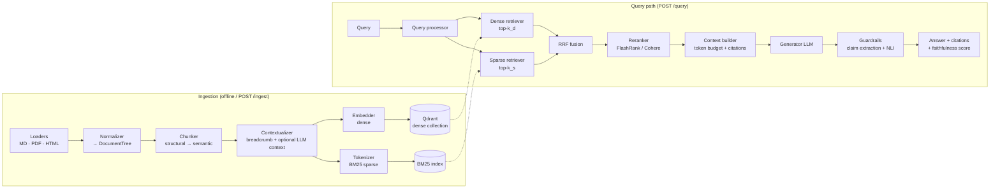
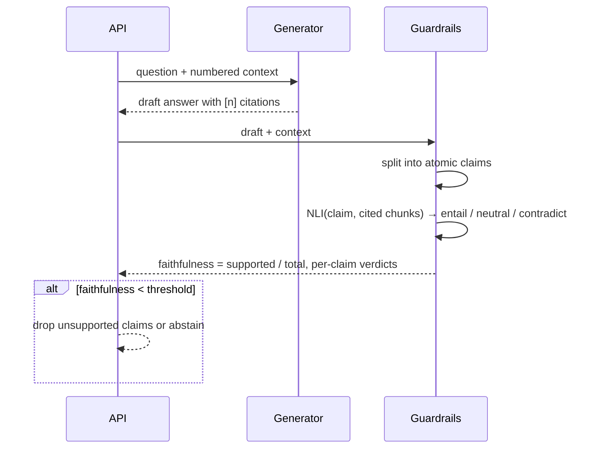

# Architecture — Production-Grade Hybrid RAG

> Status: **Spec v0.1** (design-first; implementation follows this document, test-first).

## 1. Design goals

| Goal | Concrete decision |
|---|---|
| Retrieval quality over the naive baseline | Dense + BM25 → RRF → cross-encoder rerank |
| Groundedness | Claim-level NLI verification before an answer is returned |
| Reproducibility | Deterministic ingestion (content-hash IDs), pinned models, benchmark on a public dataset with qrels |
| Runs anywhere | Every external dependency has a local fallback (Qdrant local mode, FastEmbed ONNX, FlashRank) → full test suite runs offline, no Docker required |
| Swappable components | Every stage is a `Protocol`; concrete adapters are injected via settings |

Non-goals (v1): multi-tenancy, auth, streaming UI, agentic multi-hop retrieval.

---

## 2. System overview



---

## 3. Ingestion pipeline

### 3.1 Stages and contracts

Each stage is a pure transformation with a typed Pydantic v2 boundary:

```
bytes ──Loader──▶ RawDocument ──Normalizer──▶ DocumentTree ──Chunker──▶ list[Chunk]
      ──Contextualizer──▶ list[ContextualChunk] ──Indexer──▶ IndexReport
```

| Model | Key fields |
|---|---|
| `RawDocument` | `source_uri`, `mime_type`, `content: bytes`, `sha256` |
| `DocumentTree` | `doc_id`, `title`, `sections: list[Section]` (recursive: `heading`, `level`, `blocks`) |
| `Block` | `kind: Literal["paragraph","list","table","code"]`, `text`, `page: int \| None` |
| `Chunk` | `chunk_id`, `doc_id`, `text`, `section_path: tuple[str, ...]`, `token_count`, `position` |
| `ContextualChunk` | `Chunk` + `context_prefix`, `embed_text` (prefix + text) |

### 3.2 Loaders → one canonical tree

The key idea: **all formats are normalized into the same `DocumentTree`**, so chunking logic is format-agnostic.

| Format | Library | Structure recovery |
|---|---|---|
| Markdown | `markdown-it-py` | ATX/Setext headings → section levels; fenced code kept atomic |
| HTML | `selectolax` (lexbor) | Strip `nav/footer/script/style`; `h1–h6` → levels; `<table>` → Markdown table block |
| PDF | `pymupdf` | Font-size clustering per document → heading levels; header/footer removal by repeated-line detection across pages; page number kept in `Block.page` |

### 3.3 Chunking strategy (two passes)

**Pass 1 — Structural.** Walk the tree; each section is a candidate chunk. Code blocks and tables are never split.

**Pass 2 — Semantic split (only for sections > `max_tokens`).**
1. Sentence-split the section.
2. For each gap *i*, embed the `w+1` sentences ending at *i* and the `w+1` starting at *i+1* (TextTiling-style); cosine distance between the two. Gap-centred windows keep the peak on the topic shift — symmetric per-sentence windows were measured to shift it one sentence early.
3. Break where distance > percentile `p` (default 90th) of the distances in that section.
4. Merge resulting pieces smaller than `min_tokens` into their neighbour; enforce `max_tokens` hard cap with a recursive fallback.

Sections < `min_tokens` are merged with the next sibling under the same parent.

Defaults: `min_tokens=64`, `max_tokens=512`, `overlap=0` (semantic boundaries make overlap mostly redundant; configurable).

### 3.4 Contextualization

Isolated chunks lose referents ("it", "the method above"). Two levels:

1. **Breadcrumb (always, zero cost):** `"{title} > {section_path}"` prepended to `embed_text`.
2. **LLM context (opt-in, `CONTEXTUAL_LLM=true`):** a 50–100 token summary situating the chunk within the full document ("Contextual Retrieval", Anthropic 2024). Uses prompt caching on the document body to keep cost linear.

`embed_text` feeds **both** the dense embedder and BM25 — the prefix also improves lexical matching on section terms. The original `text` is what goes into the LLM prompt.

### 3.5 Idempotency

- `doc_id = sha256(source_uri)`, `chunk_id = sha256(doc_id ‖ section_path ‖ text ‖ occurrence)` (length-prefixed parts; `occurrence` disambiguates repeated text). Position is excluded so inserting a paragraph does not re-key every later chunk.
- Re-ingesting an unchanged document is a no-op; a changed document deletes stale chunk IDs (set difference) and upserts new ones.
- `IndexReport` returns `added / unchanged / removed` counts.

---

## 4. Retrieval engine

### 4.1 Dense retrieval
- Store: **Qdrant** (local on-disk mode for dev/tests, server mode via `QDRANT_URL` in prod).
- Embeddings: `BAAI/bge-small-en-v1.5` via FastEmbed (ONNX, CPU, 384-d). Swappable through `Embedder` protocol.
- Distance: cosine; HNSW defaults (`m=16`, `ef_construct=100`).

### 4.2 Sparse retrieval
- **BM25 (Okapi)**, `k1=1.2`, `b=0.75`, implemented over a persisted inverted index (`bm25s`).
- Analyzer: lowercase → Unicode NFKC → stopwords → Snowball stemmer. Same analyzer at index and query time (unit-tested invariant).

### 4.3 Reciprocal Rank Fusion

Score-scale-free fusion of `R` ranked lists:

$$\mathrm{RRF}(d) = \sum_{r \in R} \frac{w_r}{k + \mathrm{rank}_r(d)}$$

- `k = 60` (Cormack et al., 2009), per-retriever weights `w_r` (default 1.0).
- Why RRF instead of score interpolation: cosine similarity and BM25 scores live on incomparable, query-dependent scales; ranks don't need calibration.
- Candidates: `k_d = k_s = 50` → fused top `N = 30` → reranker.

### 4.4 Reranking
- Default: **FlashRank** (`ms-marco-MiniLM-L-12-v2`, local cross-encoder).
- Optional: **Cohere Rerank** when `COHERE_API_KEY` is set.
- Cross-encoders score `(query, chunk)` jointly → much higher precision than bi-encoders, but O(N) inference — hence applied only to the fused top-N.
- Output: top `k_final = 5`.

### 4.5 Context builder
Packs reranked chunks into a token budget, ordered by score, each tagged `[n]` with `doc_id`, `section_path`, `page` for citations.

---

## 5. Generation & guardrails



Generator: **Claude** via the official `anthropic` SDK, behind an `LLMClient` protocol (fake in tests).

1. **Grounded prompt:** answer only from context, cite `[n]`, say "insufficient context" otherwise.
2. **Citation validity:** every `[n]` must reference an existing context chunk (deterministic check).
3. **Claim-level faithfulness:** sentences → atomic claims; each verified by an NLI cross-encoder (`cross-encoder/nli-deberta-v3-small`) against the chunks it cites (fallback: all context).
   `faithfulness = |entailed claims| / |claims|`.
4. **Policy (configurable):** `annotate` (return verdicts) · `filter` (remove unsupported claims) · `abstain` (below threshold → refuse).
5. **Retrieval-side guard:** if max rerank score < `min_relevance`, skip generation and abstain — the cheapest hallucination is the one never generated.

The response always exposes `faithfulness`, `claims[]`, and `citations[]`, so clients can enforce their own policy.

---

## 6. API (FastAPI)

| Method | Path | Purpose |
|---|---|---|
| `POST` | `/v1/ingest` | Upload file(s) or URL; returns `IndexReport` |
| `POST` | `/v1/query` | Full RAG: retrieve → rerank → generate → verify |
| `POST` | `/v1/retrieve` | Retrieval only (debug/eval); `mode: naive \| hybrid \| hybrid_rerank` |
| `DELETE` | `/v1/documents/{doc_id}` | Remove a document and its chunks |
| `GET` | `/health` · `/ready` | Liveness / readiness (index loaded, models warm) |

OpenAPI/Swagger at `/docs`, every schema with examples. Per-stage latency returned in a `timings` field and as structured logs.

---

## 7. Evaluation & benchmark

- **Dataset:** BEIR **SciFact** (public corpus + human relevance judgments, small enough for CI).
- **Systems compared** (same chunks, same embedder):
  1. Naive — dense only
  2. BM25 only
  3. Hybrid — dense + BM25 + RRF
  4. Hybrid + rerank
- **Retrieval metrics:** Precision@k, Recall@k, MRR@10, nDCG@10 (implemented in `eval/metrics.py`, unit-tested against hand-computed cases).
- **Generation metrics:** faithfulness (§5) and answer relevance on a sampled subset.
- `make bench` regenerates `docs/benchmark.md` + chart PNG; README numbers come only from that script — no hand-edited figures.

---

## 8. Repository layout

```
src/hybrid_rag/
  config.py            # pydantic-settings
  domain/models.py     # Pydantic v2 schemas (§3.1)
  ingestion/{loaders,normalize,chunking,contextualize,pipeline}.py
  retrieval/{dense,sparse,fusion,rerank,hybrid}.py
  generation/{llm,prompts,context}.py
  guardrails/{claims,nli,policy}.py
  api/{app,routes,deps}.py
eval/{datasets,metrics,run_benchmark}.py
tests/{unit,integration}/
```

Tooling: `uv`, `ruff`, `mypy --strict`, `pytest` (+ `pytest-asyncio`, coverage ≥ 85%), GitHub Actions CI, Dockerfile + `docker-compose` (API + Qdrant).

## 9. Testing strategy

| Layer | Examples |
|---|---|
| Unit | RRF math (ties, disjoint lists, weights); BM25 analyzer symmetry; chunker invariants (no chunk > max_tokens, code blocks intact, all text covered exactly once); metric correctness |
| Integration | Ingest fixture MD/PDF/HTML → Qdrant local → retrieve known answer; idempotent re-ingest; API contract via `httpx.AsyncClient` |
| Guardrails | Fake LLM returning a planted unsupported claim → must be flagged / filtered |

External APIs (LLM, Cohere) are behind protocols and replaced by fakes in tests — the suite runs offline.
